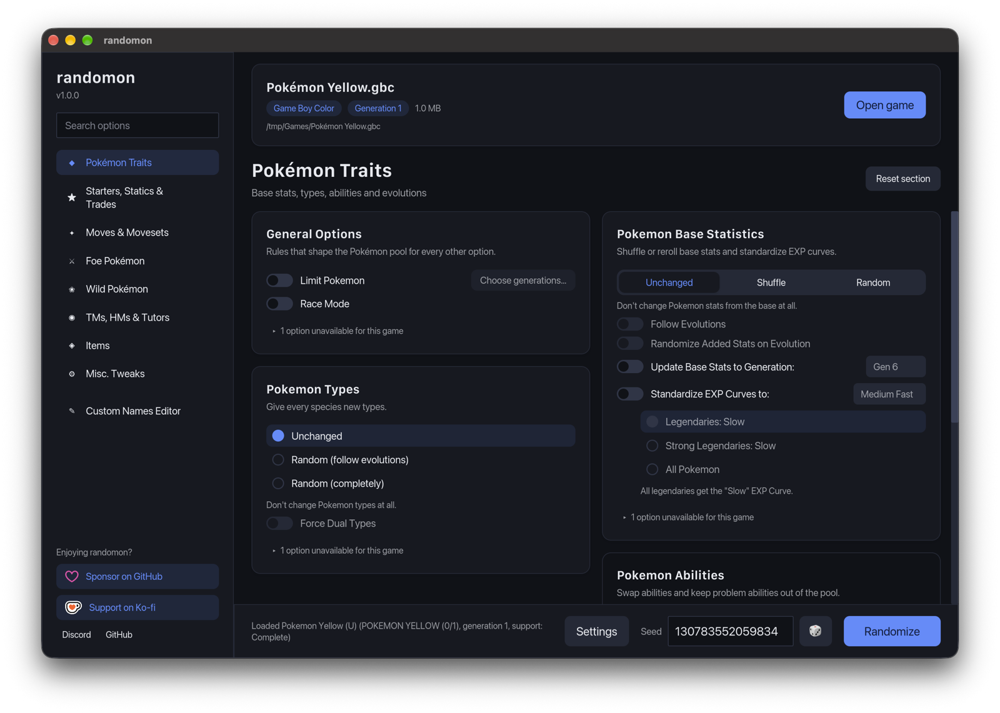
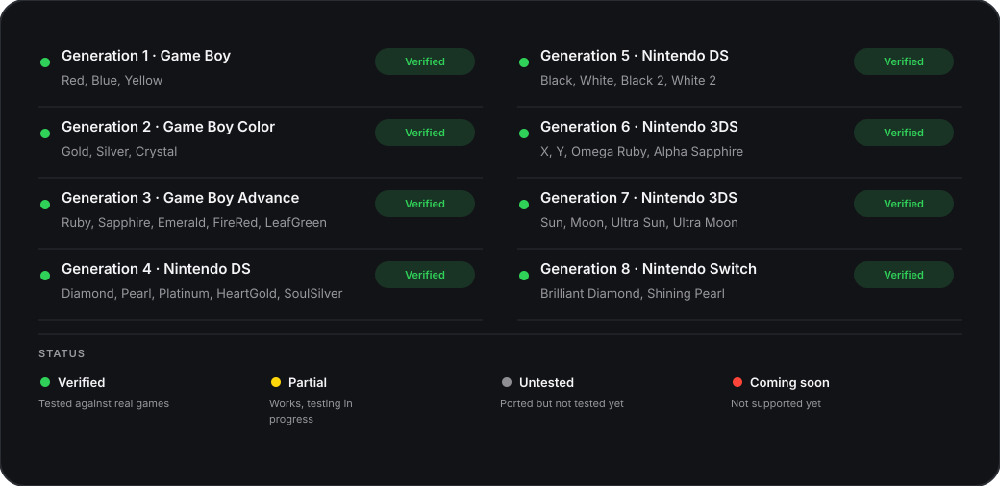

# randomon

A fast, native Pokémon randomizer for macOS, Windows and Linux

## Download

  

## Features

- Every Universal Pokemon Randomizer ZX option, in a clean native interface with search
- Same settings strings, `.rnqs` quick settings and `.rndp` presets as UPR ZX, with matching results for the same seed
- Brilliant Diamond, Shining Pearl, Sword and Shield with the same option catalog as every other game, written as mod folders for Atmosphere, Eden and Ryubing. Open the game's romfs folder to load it
- 3DS game updates and LayeredFS output
- A command-line tool that accepts UPR ZX's flags, plus `--seed` and `--settings-string`. It ships inside every download: `randomon.app/Contents/MacOS/randomon-cli` on macOS, `randomon-cli.exe` next to the app on Windows, and the AppImage itself on Linux (run it with arguments)

## Supported games

## Credits

Built on [Universal Pokemon Randomizer ZX](https://github.com/Ajarmar/universal-pokemon-randomizer-zx) by Ajarmar, darkeye and cleartonic, based on Dabomstew's Universal Pokemon Randomizer, and on [BDSP-Randomizers](https://github.com/Ai0796/BDSP-Randomizers) by Aldo796, Copycat, SanGawku, XLuma and Red. randomon ships no game data, so bring your own legally dumped games.

## Contributors

